<picture>
  <source media="(prefers-color-scheme: dark)" srcset="assets/hero-dark.svg">
  <source media="(prefers-color-scheme: light)" srcset="assets/hero-light.svg">
  
</picture>

## Who I am

I design and build digital solutions that transform opportunities into scalable products, processes and experiences.

I am a Software Developer and a Systems Information Engineering student in Argentina. The work connects a business need with the architecture, the product, and the automation around it.

<picture>
  <source media="(prefers-color-scheme: dark)" srcset="assets/about-dark.svg">
  <source media="(prefers-color-scheme: light)" srcset="assets/about-light.svg">
  
</picture>

## Core pillars

<picture>
  <source media="(prefers-color-scheme: dark)" srcset="assets/pillars-dark.svg">
  <source media="(prefers-color-scheme: light)" srcset="assets/pillars-light.svg">
  
</picture>

Technology, product, automation, and business are one system. The diagram names the four concerns. None of them stands in for the others.

## Tech stack

<picture>
  <source media="(prefers-color-scheme: dark)" srcset="assets/stack-dark.svg">
  <source media="(prefers-color-scheme: light)" srcset="assets/stack-light.svg">
  
</picture>

## Featured work

### [proyecto-individual-TS](https://github.com/Lautarolecube/proyecto-individual-TS)

Coursework in object-oriented TypeScript, with Vitest unit tests and continuous integration on GitHub Actions.

`TypeScript` · `Vitest` · `GitHub Actions`

### [gestor-de-correo](https://github.com/Lautarolecube/gestor-de-correo)

Java model of an email manager. A message carries subject, body, sender, and contact. The public source also includes folders for received mail, sent mail, drafts, and spam, plus a contact list.

`Java`

## GitHub activity

<picture>
  <source media="(prefers-color-scheme: dark)" srcset="assets/activity-dark.svg">
  <source media="(prefers-color-scheme: light)" srcset="assets/activity-light.svg">
  
</picture>

The figures are written into the repository by `npm run generate`, from the public GitHub API. If that API fails on a later run, the previous snapshot stays. A third-party stats image is not required for this section to render.

Language counts use the primary language of public repositories and exclude forks.

## Contact

[GitHub](https://github.com/Lautarolecube) · [LinkedIn](https://www.linkedin.com/in/lautaro-l%C3%B3pez-lecube-7a9b3a25b) · [lautalecube@gmail.com](mailto:lautalecube@gmail.com)
