<div align="center">


<br>

<!-- NAME / TAGLINE - animated typing -->
# Hi, I'm Lautaro 👋
<a href="https://github.com/Lautarolecube">

  
</a>

<br>

</div>


  
</a>

## This is me

- 💻 Systems Information Engineering student with a strong focus on **software, systems architecture and digital products**.

- 🚀 I build solutions that combine **frontend, backend, integrations, automation and business logic** instead of treating technology as an isolated layer.

- ⚙️ Currently working with **digital operations, integrations, order flows, automation and operational monitoring** in e-commerce environments.

- 🧠 Interested in **Artificial Intelligence, automation, software engineering, product development and digital business**.

- 📊 I enjoy turning complex operations into **observable systems, dashboards, workflows and measurable processes**.

- 🧩 I like working on problems where **technology meets real business constraints**.

- 🌎 Building from Argentina, thinking globally.

---

## What I build

```text
Opportunity / Problem
        ↓
    Discovery
        ↓
 Product Design
        ↓
 System Design
        ↓
 Development
        ↓
 Integrations
        ↓
 Automation
        ↓
 Measurement
        ↓
   Optimization
```

My main areas of work:

**Technology**  
Software architecture, web applications, APIs, integrations and data flows.

**Product**  
Discovery, requirements, UX, MVP definition and product evolution.

**Automation**  
Workflow automation, event-driven processes, AI agents and operational tooling.

**Business**  
Process improvement, digital transformation, KPIs and scalable solutions.

---

## Tech I work with

### Frontend

`React` `TypeScript` `Tailwind CSS` `shadcn/ui`  
`Framer Motion` `GSAP` `Three.js` `React Three Fiber`

### Backend & Data

`Node.js` `REST APIs` `Supabase` `PostgreSQL`  
`Redis` `RabbitMQ`

### Automation & Integrations

`n8n` `Webhooks` `APIs` `Event-driven systems`

### Tools

`Git` `GitHub` `Docker` `Cursor` `ORCA`
`Figma` `Jira` 

---

## Selected work

### ⚡ Operational Management Platform

Web platform designed to manage multi-location maintenance operations.

`React` · `Supabase` · `Google OAuth` · `Dashboards` · `Operational KPIs`

---

### 📦 E-commerce Fulfillment Monitoring

Operational dashboard focused on monitoring the order lifecycle from **OMS → Batch → WMS → Ready to Ship**, including SLA monitoring and operational alerts.

`Data pipelines` · `n8n` · `BigQuery` · `SLA Monitoring` · `E-commerce`

---

### 🤖 CX & Process Automation

Automation and integration solutions connecting customer experience platforms, e-commerce ecosystems and operational processes.

`Freshdesk` · `Freshcaller` · `VTEX` · `n8n` · `APIs` `Event-driven systems`

---

### 🌐 Command Center Marketing and Business

An interactive system exploring the convergence between:

`Sales` × `Calendar` × `Automation` × `Business`

Built with:

`React` · `Typescript` · `Supabase` · `Vercel` · `Owner System`

---

## Currently exploring

- AI Agents
- Applied Artificial Intelligence
- Event-driven architectures
- Business process automation
- Product engineering
- SaaS development
- Data-driven operations
- Human-centered digital products

---

## My approach

> Technology is valuable when it transforms a real problem into a simpler, measurable and scalable system.

I like building products with a simple principle:

**Understand the problem → design the system → automate what makes sense → measure the result → optimize.**

---
## Stats


<br/>


<br/>


<br/>


<br/>


## Let's connect

I'm always interested in conversations around:

**Software · Product · Automation · AI · Digital Business · Entrepreneurship**

<a href="https://github.com/Lautarolecube">
  
</a>


---

`Build systems. Automate complexity. Create value.`
